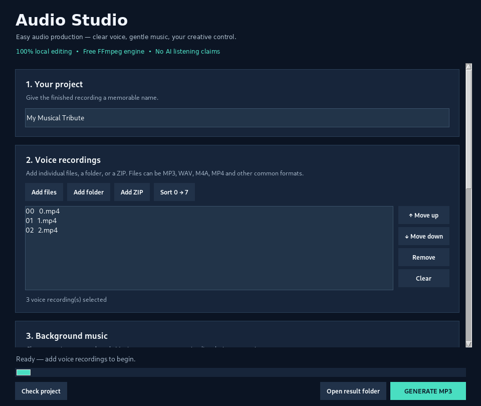

# Audio Studio

**An approachable, privacy-first audio mixer for voice recordings and background music — now with chat-first setup, a simple desktop form and a portable AI Agent Skill.**

[](LICENSE)
[](https://www.python.org/downloads/)
[](https://agentskills.io/specification)

**Version 1.2.1 · November 2026 · Open source · No paid audio service required**

Audio Studio assembles numbered voice files, gently balances their levels, places music underneath them, creates exactly timed gaps, applies fades, and exports a **320 kbps stereo MP3**. The optional voice/music WAV stems remain separately editable in Movavi, Audacity, and similar editors.

> **What it is:** a working local Python/FFmpeg audio editor, a Tkinter form, and the portable `SKILL.md` instructions.
> **What it is not:** a hosted website, an emotion-recognition system, or a magically self-running GitHub link. AI assistants need both access to the files **and** an environment that can run FFmpeg.



## Start in a new AI chat — the easy way

1. Download the **[dedicated Audio Studio skill ZIP](dist/audio-studio-skill.zip)**; it is different from the repository source ZIP.
2. Upload/install the skill ZIP into an AI chat and let the assistant **read `SKILL.md`**. It is instructed to show an [eight-line welcome](forms/welcome-message.md) explaining Audio Studio and the next action. If no response appears, ask: **“Read the attached Audio Studio ZIP and follow SKILL.md.”** Then type **“Start Audio Studio.”**
3. **Attach your voice recordings** (separate audio files or a ZIP) and optional background instrumental when prompted.
4. The assistant should reuse any settings you already gave, **show the proposed timeline**, and request approval before rendering. Audio rendering works only when the chat has access to actual media files and Python/FFmpeg tools. Otherwise use the local desktop form.

**Chat-first means a conversational setup; it does NOT guarantee that ChatGPT, Claude or Gemini automatically displays a custom graphical uploader.** See [illustrated activation examples](docs/CHAT_FIRST.md) and the [compact chat form](forms/chat-form.md).

### Sample chat prompt

> Start Audio Studio. Project: My Audio Project. Gap between clips: 3 seconds. Music: quiet. Gentle low-rumble cleanup: on. Normalize voice: on. Mute music during final recording: off. Ask only for missing audio files; show the timeline before rendering.

## 1. Get started in 60 seconds

| Your goal | What to do |
| --- | --- |
| **Use the Windows form** | Download the repository, install Python 3.10+ and [FFmpeg](https://ffmpeg.org/download.html), then double-click `Start_Audio_Studio_Windows.bat`. |
| **Use the Mac/Linux form** | Install Python with Tkinter and FFmpeg, then run `bash Start_Audio_Studio_Mac_Linux.sh`. |
| **Use an AI assistant** | Download **[`dist/audio-studio-skill.zip`](dist/audio-studio-skill.zip)**, install/attach it where supported, then say **Start Audio Studio**. See [AI platform guide](docs/COMPATIBILITY.md). |
| **Use the command line** | Run `python scripts/audio_studio.py validate --config examples/project.example.json` after replacing the sample file paths with your own. Then run `render` instead of `validate`. |

**Important ZIP distinction:** GitHub's **Code → Download ZIP** gives you the entire **source repository**. The file under `dist/` is a specifically structured **installable skill ZIP** for clients that accept skill archives. They are not interchangeable in every AI product.

## 2. Simple form: five steps

1. **Name your project.**
2. **Add voice files:** select individual recordings, a folder, or a ZIP; reorder them using the controls.
3. **Choose optional background music:** decide how quiet it should be and where it must be muted.
4. **Set pauses and cleanup:** default five seconds after the first clip, three seconds between the rest, optional five-second music outro.
5. **Generate the MP3:** choose an output folder and optionally export separately editable WAV tracks.

The form preserves original recordings. It does **not** alter the words, speaking rate, or pitch. Long edge-silence trimming and heavier noise reduction are off by default because they may remove intentional pauses or create artifacts.

## 3. What Audio Studio can and cannot do

| Supported and tested | Important limitation |
| --- | --- |
| Ordered MP3/WAV/M4A/MP4 voice clips, plus other FFmpeg-readable formats | The installed FFmpeg build must support the input codec. |
| Recordings in folders, single files, or ZIP archives through the desktop form | An ordinary chat link alone does not guarantee file access. |
| Voice-level balancing, gentle high-pass filtering, optional FFT denoising | This is technical processing, not human listening or emotional interpretation. |
| Exact insertion of configured gaps and optional music-only ending | Silence internal to recordings is preserved by default. |
| Quiet background music and muted final narration | Per-sentence music decisions require explicit settings or an editing workflow. |
| 320 kbps stereo MP3, optional synchronized WAV stems, JSON edit report | A normal MP3 does not contain two independently editable tracks. |
| Automated checks of exported file duration, codec availability and gap positions | No claim that every transition sounds musically perfect. Human preview remains necessary. |

Current version supports one background source and uses safe technical defaults. It does not import/export proprietary Movavi `.mepx` projects or transcribe the recordings.

## 4. AI assistant usage — copy this prompt

> Start Audio Studio using the attached skill ZIP. Read `SKILL.md`. Ask only for missing recordings and optional music. Preserve my settings and show the proposed timeline before rendering. If this environment has Python, FFmpeg and access to the actual audio files, validate and render the project with `scripts/audio_studio.py`. If not, tell me the limitation and guide me to run the included form locally. Do not claim to have listened to or processed audio unless the relevant tools were actually used.

The [Agent Skills open specification](https://agentskills.io/specification) makes `SKILL.md` portable, **but not every AI chat app installs ZIPs or executes FFmpeg**. Use the [compatibility guide](docs/COMPATIBILITY.md) for platform-specific advice.

## 5. Command-line example

Create your own `project.json` using [`examples/project.example.json`](examples/project.example.json). Use **real local paths** for voice files and music. For a simple chat session, first convert [`examples/chat-session.example.json`](examples/chat-session.example.json) using `scripts/chat_bridge.py`.

```bash
python scripts/audio_studio.py validate --config project.json
python scripts/audio_studio.py render --config project.json
```

The output folder will contain:

```text
My_Project_FINAL.mp3            # final mixed soundtrack
My_Project_REPORT.json          # precise timeline and operations
My_Project_VOICE_ONLY.wav       # optional synchronized stem
My_Project_MUSIC_ONLY.wav       # optional synchronized stem
```

`additional_instructions` in the form or JSON is kept in the report **but is not interpreted by the audio engine**. Supported edits must be converted to explicit settings. The skill instructs AI assistants never to claim otherwise.

## 6. Development and automated tests

**Requirements:** Python 3.10+; FFmpeg/FFprobe on the system PATH. The processing engine uses the Python standard library, so no `pip install` is needed.

```bash
python -m compileall -q scripts tests
python -m unittest discover -s tests -p 'test*.py' -v
python scripts/build_skill_zip.py --check
```

Tests generate **synthetic audio**, not private user recordings. They cover sequence order, gap durations, music-only outro, MP3 export, and absolute silence of the music stem during a final voice-only clip.

See [Architecture](docs/ARCHITECTURE.md), [Changelog](CHANGELOG.md), and [Contributing](CONTRIBUTING.md). GitHub Actions runs these checks on contributions.

## 7. Privacy, safety and licensing

- **Local by default:** the application does not upload your recordings or phone home.
- **Keep secrets and audio private:** do not commit personal recordings, commercial music, or API keys to a public repository.
- **Licensing:** the source code is MIT-licensed. Any music or recordings you use retain their separate copyrights and licensing obligations.
- **No voice impersonation:** this utility edits supplied audio and does not synthesize or clone voices.
- **Original recordings remain untouched.** Review generated audio before publishing.

Read [SECURITY.md](SECURITY.md) for reporting security issues and [PORTABILITY.md](PORTABILITY.md) for operational caveats.

---

**Maintained by [vsbalajee](https://github.com/vsbalajee).** Contributions and bug reports are welcome. See [CONTRIBUTING.md](CONTRIBUTING.md).
